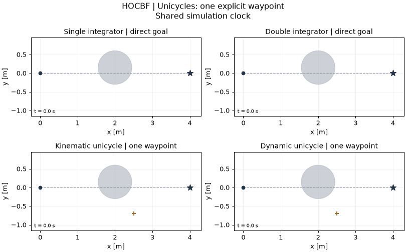
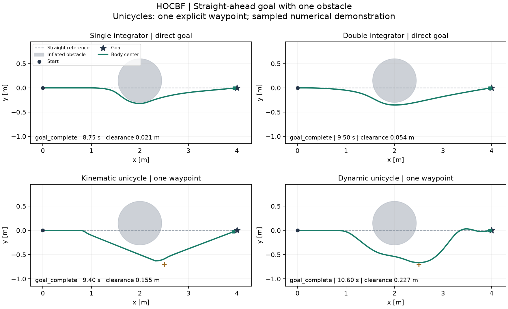
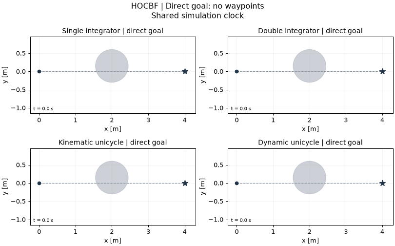
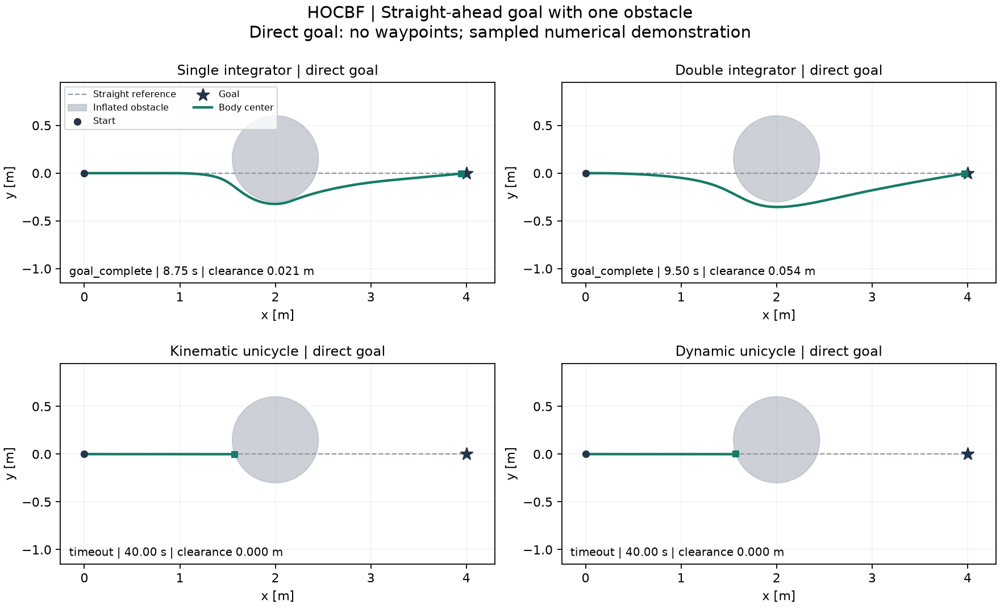

# HOCBF-Python

Standalone Python reproduction and clearly separated model extensions for **High-Order Control Barrier Functions** by Wei Xiao, Calin Belta. [Original paper](https://ieeexplore.ieee.org/document/9516971/). This is a community research implementation, not an official author repository.

[中文说明](README_ZH.md) · [Model contracts](docs/MODEL_SCOPE.md) · [Results](docs/RESULTS.md) · [Source and licensing](THIRD_PARTY_NOTICES.md)

## Original paper

| Field | Details |
|---|---|
| Title | **High-Order Control Barrier Functions** |
| Authors | Wei Xiao, Calin Belta |
| Publication | IEEE Transactions on Automatic Control, vol. 67, no. 7, pp. 3655–3662, July 2022 (first published online in 2021). |
| DOI | [10.1109/TAC.2021.3105491](https://doi.org/10.1109/TAC.2021.3105491) |
| Publisher | [IEEE Xplore](https://ieeexplore.ieee.org/document/9516971/) |
| Open full text | [Author-hosted published PDF](https://calinbelta.com/wp-content/uploads/2023/12/High-Order_Control_Barrier_Functions.pdf) |

Please cite this paper when using the original method. The implementation scope and model extensions are described below; repository authorship is listed separately under [Author and maintainer](#author-and-maintainer).

## Reproduction scope

Original author ACC and Robot2D MATLAB problems have a strict local Python port, checked against 2,800 recorded native QPs and full closed loops. Because no upstream license is present, this direct source translation stays in ignored .local-reference; it is not included in public archives or wheels.

Public code independently implements the HOCBF recursion with linear class-K functions and a nominal-tracking QP. Original Robot2D uses [x,y,theta,v] with [yaw-rate,acceleration], fractional powers, its own CLFs and source quirks; it is not the new five-state demo.

## Install and run

Python 3.12 is the locally tested runtime. Public model examples are self-contained and need no sibling repository, original research workspace or MATLAB installation.

```sh
python3.12 -m venv .venv
source .venv/bin/activate
python -m pip install -r requirements-tested.txt
python -m pip install -e .
```

## Single-obstacle demo

### Scenario

The controlled body center starts at `(0, 0)` m and the final goal is `(4, 0)` m. One obstacle at `(2, 0.15)` m with **inflated exclusion radius `0.45 m`** blocks the direct start–goal line. This radius already includes the chosen body-size/clearance allowance. Unicycles start facing +x with a 0.15 m center offset; second-order states start at rest. The slight lateral obstacle offset breaks exact symmetry. “Straight-goal” describes the start–goal line; the actual reference targets depend on the navigation configuration below.

### Navigation and waypoint usage

**Waypoint navigation: used by the kinematic and dynamic unicycles only.** The two integrator models track the final goal directly. The unicycle results include a manually specified intermediate navigation target and a demo-specific nominal tracker.

| Models | Waypoint navigation | Intermediate targets (m) | Switching rule |
|---|---|---|---|
| Single / double integrator | No | None | Final goal throughout |
| Kinematic / dynamic unicycle | Yes — 1 waypoint | `(2.5, -0.7)` | Activate when body-center `x >= 0.8 m`; switch to final goal when distance to waypoint `< 0.20 m` |

The waypoints are fixed navigation inputs supplied by this demo, not outputs generated by the CBF controller. The displayed successes include that navigation layer; the direct-goal diagnostic below shows what happens when it is disabled.

### Animation

**Navigation shown: integrators use direct goals; unicycles use waypoint navigation.**



### Trajectories



### Results

| Model | Waypoint navigation | Outcome | Time (s) | Final error (m) | Min. sampled clearance (m) | Fallbacks |
|---|---|---|---:|---:|---:|---:|
| Single integrator | **No** | `goal_complete` | 8.75 | 0.05395 | 0.02105 | 0 |
| Double integrator | **No** | `goal_complete` | 9.50 | 0.03200 | 0.05430 | 0 |
| Kinematic unicycle | **Yes** | `goal_complete` | 9.40 | 0.07771 | 0.15512 | 0 |
| Dynamic unicycle | **Yes** | `goal_complete` | 10.60 | 0.02962 | 0.22676 | 0 |

[Summary, parameters and source hashes](evidence/single_obstacle/summary.json) · [Per-model states, controls and solver events](evidence/single_obstacle/)

### Reproduce the demo

```sh
python -m hocbf demo --output runs/single_obstacle
python -m hocbf demo --model dynamic_unicycle --output runs/single_obstacle_dynamic
python examples/single_obstacle/run.py --output runs/single_obstacle_example
```

The first command runs all four models; the second runs one model. All commands save PNG, GIF, NPZ and JSON results. Add `--no-animation` to skip GIF rendering. Use a fresh output folder for each run; existing results are protected. Timeout, infeasibility and sampled-collision outcomes are retained in `summary.json`; inspect the recorded outcome to determine task completion.

### Parameters and limitations

The demo uses `dt=0.05 s`, `vmax=0.7`, a 0.15 m unicycle center offset, and a 40 s limit. HOCBF gains remain `(1.5, 1.3)` for relative degree two and `1.5` for degree one. The unicycle nominal tracker maps desired center velocity `0.7 * (target - center)` through offset-point kinematics; dynamic velocity tracking uses gains `(3, 4)`. The unicycles initially track the final goal, activate the waypoint at the threshold above, then return to the final goal. The unchanged filter intervenes in all four recorded runs.

Completion requires body-center goal error below `0.15 m` plus the [model-specific stopping condition](docs/MODEL_SCOPE.md) at consecutive hold endpoints for `0.5 s`. Clearance is checked at 21 independent DOP853 samples per hold. Positive sampled clearance is numerical evidence, not a continuous-time safety proof. These are model-extension demos with disclosed navigation and controller settings, separate from original paper experiments and the earlier diagonal-goal fixtures. Different navigation and speed settings do not support a performance ranking.

### Direct-goal results (no waypoints)

**Waypoint navigation: disabled in all four models below.**

Only waypoint navigation is disabled here. Geometry, initial state, controller settings, demo-specific nominal tuning and dynamic extensions remain the same as in the default demo. These records are model-extension diagnostics, not original-paper benchmark results.

With the same settings and waypoint navigation disabled, both integrators complete, while both unicycles stop near the obstacle and time out at 40 s with about 2.424 m goal error. [Direct-goal numerical records](evidence/single_obstacle_direct/summary.json) retain these outcomes. The guided unicycle successes include navigation assistance.

| Model | Waypoint navigation | Outcome | Time (s) | Final error (m) | Min. sampled clearance (m) | Fallbacks |
|---|---|---|---:|---:|---:|---:|
| Single integrator | **No** | `goal_complete` | 8.75 | 0.05395 | 0.02105 | 0 |
| Double integrator | **No** | `goal_complete` | 9.50 | 0.03200 | 0.05430 | 0 |
| Kinematic unicycle | **No** | **`timeout`** | 40.00 | 2.42391 | ≈0 (5.00e-16) | 0 |
| Dynamic unicycle | **No** | **`timeout`** | 40.00 | 2.42407 | ≈0 (5.55e-16) | 0 |

Time is the executed duration; a timeout or collision is not task completion. Near-zero clearance at numerical precision indicates contact with the inflated boundary, not a useful positive margin.





[No-waypoint summary and parameters](evidence/single_obstacle_direct/summary.json) · [Complete no-waypoint records](evidence/single_obstacle_direct/)

```sh
python -m hocbf demo --guidance direct --no-animation --output runs/single_obstacle_direct
```

## Original problem entry

```sh
# Use the environment above
python -m hocbf original --suite all --output runs/original
```

The local-only HOCBF port is intentionally absent from a clean public clone; the command gives an explicit explanation. The public recursive implementation and all four demos remain runnable. Obtain redistribution permission before adding that strict translation to Git.

## Other examples and verification

The `run` commands below execute the earlier diagonal-goal fixture; `demo` runs the single-obstacle fixture above. [Observed results](docs/RESULTS.md) retain prior failures and their source snapshots. Model equations, state/input ordering and example entry points are documented in [MODEL_SCOPE.md](docs/MODEL_SCOPE.md).

```sh
python -m unittest discover -s tests -v
python -m hocbf verify --output runs/verification.json
python -m hocbf run --model single_integrator --output runs/single_integrator
python -m hocbf run --model double_integrator --output runs/double_integrator
python -m hocbf run --model kinematic_unicycle --output runs/kinematic_unicycle
python -m hocbf run --model dynamic_unicycle --output runs/dynamic_unicycle
```

## Author and maintainer

Independent Python implementation, model extensions, demos and repository maintenance: **[Yo Kotaku (@youkoutaku)](https://github.com/youkoutaku)**. Original paper authors: **Wei Xiao, Calin Belta**. Cite the original paper when using the method; [CITATION.cff](CITATION.cff) records repository authorship separately.

## AI-assisted coding disclosure

This repository was developed with **AI-assisted coding using OpenAI Codex**. AI assistance was used for implementation and refactoring, tests, demo tooling, and documentation. The [verification and results records](docs/RESULTS.md) describe the checks actually performed and their limitations. This disclosure concerns repository development; credit for the original methods remains with the paper authors listed above.

## Publication preparation

```sh
python scripts/export_public.py --output dist/HOCBF-Python-public.zip
```

The archive uses an explicit source/documentation allowlist and includes a SHA256 manifest. It excludes `.venv`, `.upstream`, `.local-reference`, `runs`, Git internals and old archives. Choose a new filename if the target ZIP exists. [GitHub Actions](https://github.com/youkoutaku/HOCBF-Python/actions/workflows/ci.yml) runs the unit tests and formula verification on Ubuntu with Python 3.12. The export command creates a local archive.

## License and attribution

**MIT covers independent implementation and new code only.** Original paper attribution, retained third-party notices and redistribution exclusions are documented in [THIRD_PARTY_NOTICES.md](THIRD_PARTY_NOTICES.md) and [LICENSE_STATUS.md](LICENSE_STATUS.md). Repository authorship does not change upstream ownership or licensing.
