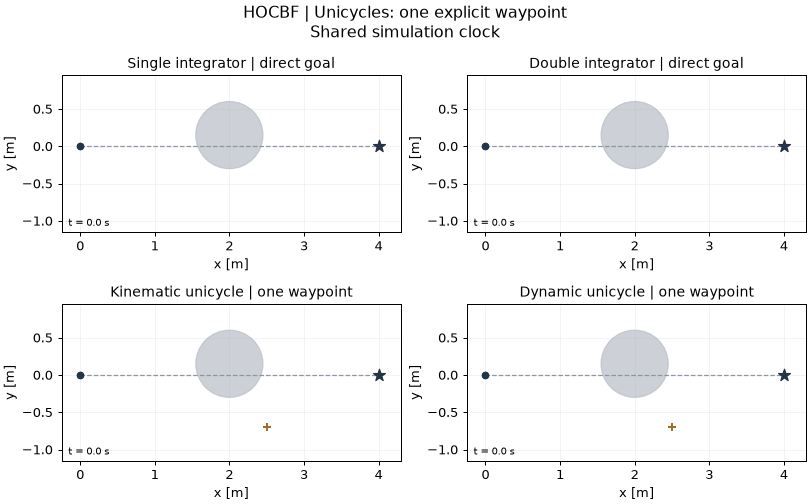
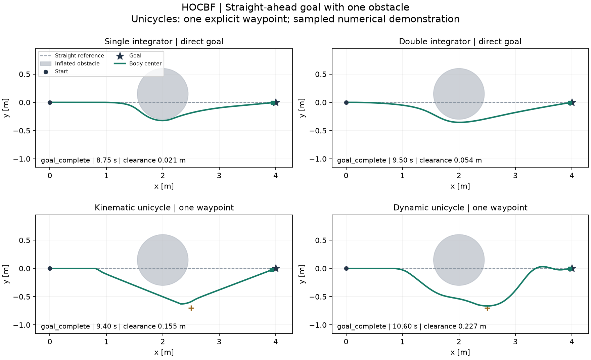
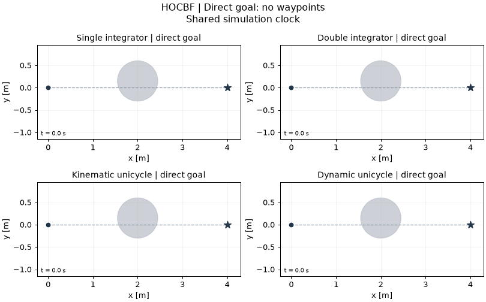
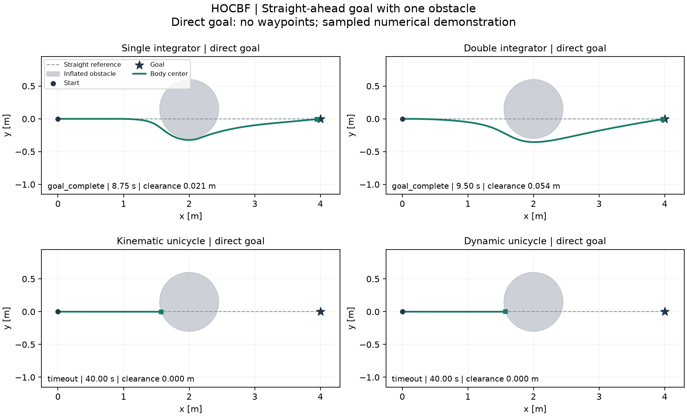

# HOCBF-Python 中文说明

本仓库依据 **[High-Order Control Barrier Functions](https://ieeexplore.ieee.org/document/9516971/)** 整理独立 Python 实现与明确区分的模型扩展。原论文作者：**Wei Xiao, Calin Belta**。这是社区研究实现，不是原作者官方仓库。

[English](README.md) · [模型说明](docs/MODEL_SCOPE.md) · [运行结果](docs/RESULTS.md) · [来源与许可](THIRD_PARTY_NOTICES.md)

## 原论文信息

| 项目 | 信息 |
|---|---|
| 题目 | **High-Order Control Barrier Functions** |
| 作者 | Wei Xiao, Calin Belta |
| 发表信息 | IEEE Transactions on Automatic Control，第 67 卷第 7 期，3655–3662 页，2022 年 7 月（2021 年首次在线发表）。 |
| DOI | [10.1109/TAC.2021.3105491](https://doi.org/10.1109/TAC.2021.3105491) |
| 出版社入口 | [IEEE Xplore](https://ieeexplore.ieee.org/document/9516971/) |
| 开放全文 | [作者提供的正式出版 PDF](https://calinbelta.com/wp-content/uploads/2023/12/High-Order_Control_Barrier_Functions.pdf) |

使用原始方法时请引用此论文。实现范围与模型扩展见下文；仓库开发署名单独列于[作者与维护者](#作者与维护者)。

## 复现范围

原作者 ACC、Robot2D MATLAB 问题的严格本地 Python 移植已与 2,800 个原生 QP 和完整闭环核对。由于上游没有声明许可证，该严格移植只保存在忽略目录 `.local-reference/`，不进入公开 Git、wheel 或 ZIP。

公开代码独立实现线性 class-K 函数下的 HOCBF 递推与名义跟踪 QP。原 Robot2D 使用 `[x,y,theta,v]`、`[yaw-rate,acceleration]`、分数幂与原始 CLF；公开五状态模型扩展与其明确分开。

## 安装与运行

本地验证使用 Python 3.12。公开模型示例可独立运行，不依赖兄弟仓库、原研究工作区或 MATLAB。

```sh
python3.12 -m venv .venv
source .venv/bin/activate
python -m pip install -r requirements-tested.txt
python -m pip install -e .
```

## 单障碍物 demo

### 场景

受控机体中心从 `(0, 0)` m 出发，最终目标为 `(4, 0)` m。障碍物中心为 `(2, 0.15)` m，**膨胀排斥半径为 `0.45 m`**，挡住起点到终点的直线；该半径已包含所选机器人尺寸/间隙裕量。独轮车初始朝向为 +x，机体中心偏置为 0.15 m；二阶状态从静止出发。障碍物的小幅横向偏移用于打破完全对称。“直线目标”描述起终点连线，实际参考目标取决于下面的导航配置。

### 导航与 waypoint 使用

**Waypoint 导航：仅运动学独轮车和动力学独轮车使用。** 两类积分器直接跟踪最终目标；两类独轮车的结果包含人工指定的中间导航目标及 demo 专用名义跟踪器。

| 模型 | Waypoint 导航 | 中间目标 (m) | 切换规则 |
|---|---|---|---|
| 单积分器 / 双积分器 | 否 | 无 | 始终跟踪最终目标 |
| 运动学 / 动力学独轮车 | 是，1 个航点 | `(2.5, -0.7)` | 机体中心 `x >= 0.8 m` 时启用；距航点 `< 0.20 m` 时切回最终目标 |

这些航点是 demo 人工给定的导航输入，不是 CBF 控制器自动生成的路径。图像与结果包含该导航层的作用；关闭导航后的真实结局见下方无航点诊断。

### 动画

**图中导航：积分器直接跟踪终点，独轮车使用 waypoint 导航。**



### 轨迹



### 实测结果

| 模型 | Waypoint 导航 | 实测结局 | 时间 (s) | 最终误差 (m) | 最小采样间隙 (m) | 回退次数 |
|---|---|---|---:|---:|---:|---:|
| 单积分器 | **否** | `goal_complete` | 8.75 | 0.05395 | 0.02105 | 0 |
| 双积分器 | **否** | `goal_complete` | 9.50 | 0.03200 | 0.05430 | 0 |
| 运动学独轮车 | **是** | `goal_complete` | 9.40 | 0.07771 | 0.15512 | 0 |
| 动力学独轮车 | **是** | `goal_complete` | 10.60 | 0.02962 | 0.22676 | 0 |

[汇总、参数与源码哈希](evidence/single_obstacle/summary.json) · [逐模型状态、控制与求解事件](evidence/single_obstacle/)

### 复现 demo

```sh
python -m hocbf demo --output runs/single_obstacle
python -m hocbf demo --model dynamic_unicycle --output runs/single_obstacle_dynamic
python examples/single_obstacle/run.py --output runs/single_obstacle_example
```

第一条命令运行全部四模型，第二条仅运行一个模型。命令输出 PNG、GIF、NPZ 和 JSON；加 `--no-animation` 可跳过 GIF。每次请使用新的输出目录，已有结果不会被覆盖。demo 超时、不可行或出现采样碰撞时会在 `summary.json` 中保留真实结局；任务是否完成以记录的 outcome 为准。

### 参数与适用边界

本 demo 使用 `dt=0.05 s`、`vmax=0.7`、独轮车中心偏置 0.15 m 和 40 s 时限。HOCBF 增益保持为相对阶二的 `(1.5, 1.3)`、相对阶一的 `1.5`。独轮车名义跟踪器将期望中心速度 `0.7 * (目标点 - 中心)` 按偏置点运动学映射成速度；动力学版本的速度跟踪增益为 `(3, 4)`。独轮车先跟踪终点，在上述阈值处启用航点，再切回终点。四次记录中未修改的滤波器均有干预。

完成判据是机体中心终点误差 `< 0.15 m`，并在连续控制周期末满足[各模型停止条件](docs/MODEL_SCOPE.md)，累计 `0.5 s`。每个保持区间用 DOP853 独立检查 21 个采样点；正采样间隙不构成连续时间安全证明。这些属于明确披露导航与控制配置的模型扩展示例，与原论文实验、旧斜向目标示例分别记录。不同导航与限速配置不能用于方法性能排名。

### 无 waypoint 的逐模型结果

**下方四种模型全部关闭 waypoint 导航。**

这里仅关闭 waypoint 导航；场景、初态、控制器参数、demo 专用名义跟踪调节及动态扩展保持不变。这些记录属于模型扩展诊断，不是原论文基准结果。

相同参数下关闭 waypoint 导航，两类积分器完成，两类独轮车在障碍物附近停止并于 40 s 超时，终点误差约 2.424 m。[无航点数值记录](evidence/single_obstacle_direct/summary.json)保留这些结局；带引导独轮车的成功包含导航辅助的作用。

| 模型 | Waypoint 导航 | 实测结局 | 时间 (s) | 最终误差 (m) | 最小采样间隙 (m) | 回退次数 |
|---|---|---|---:|---:|---:|---:|
| 单积分器 | **否** | `goal_complete` | 8.75 | 0.05395 | 0.02105 | 0 |
| 双积分器 | **否** | `goal_complete` | 9.50 | 0.03200 | 0.05430 | 0 |
| 运动学独轮车 | **否** | **`timeout`** | 40.00 | 2.42391 | ≈0 (5.00e-16) | 0 |
| 动力学独轮车 | **否** | **`timeout`** | 40.00 | 2.42407 | ≈0 (5.55e-16) | 0 |

表中时间是实际执行时长，超时或碰撞不代表任务完成。接近机器精度的零间隙表示处于膨胀边界附近，不能视为有效正安全裕量。





[无航点汇总与参数](evidence/single_obstacle_direct/summary.json) · [完整无航点记录](evidence/single_obstacle_direct/)

```sh
python -m hocbf demo --guidance direct --no-animation --output runs/single_obstacle_direct
```

## 原文问题入口

```sh
python -m hocbf original --suite all --output runs/original
```

严格移植仅在本地参考目录可用，公开克隆中不包含该未获许可源码；该命令会明确说明缺失原因。公开 HOCBF 递推与四模型 demo 均可独立运行。

## 其他示例与验证

以下 `run` 命令运行旧斜向目标场景；`demo` 运行上面的单障碍物场景。[运行结果](docs/RESULTS.md)保留历史失败及其源码快照。模型方程、状态/输入顺序和四类示例入口见[模型说明](docs/MODEL_SCOPE.md)。

```sh
python -m unittest discover -s tests -v
python -m hocbf verify --output runs/verification.json
python -m hocbf run --model single_integrator --output runs/single_integrator
python -m hocbf run --model double_integrator --output runs/double_integrator
python -m hocbf run --model kinematic_unicycle --output runs/kinematic_unicycle
python -m hocbf run --model dynamic_unicycle --output runs/dynamic_unicycle
```

## 作者与维护者

独立 Python 实现、模型扩展、demo 与仓库维护：**[Yo Kotaku（@youkoutaku）](https://github.com/youkoutaku)**。原论文作者为 **Wei Xiao, Calin Belta**。使用方法时请引用原文；[CITATION.cff](CITATION.cff)单独记录仓库作者信息。

## AI 辅助编程声明

本仓库开发使用了 **OpenAI Codex 辅助编程（AI coding）**，涉及代码实现与重构、测试、demo 工具和文档编写。[验证与结果记录](docs/RESULTS.md)说明了实际执行的检查及其适用边界。本声明针对仓库开发过程；原始方法的学术贡献归属于上述论文作者。

## 发布准备

```sh
python scripts/export_public.py --output dist/HOCBF-Python-public.zip
```

公开 ZIP 使用明确的源码/文档白名单，包含逐文件 SHA256 清单；排除 `.venv`、`.upstream`、`.local-reference`、`runs`、Git 内部文件及旧归档。若 ZIP 已存在，请换一个输出文件名。[GitHub Actions](https://github.com/youkoutaku/HOCBF-Python/actions/workflows/ci.yml)在 Ubuntu / Python 3.12 上运行单元测试与公式验证。导出命令生成本地归档。

## 许可与归属

**MIT 仅覆盖独立实现及新增代码。** 原论文归属、保留的第三方声明和再分发排除项见[第三方说明](THIRD_PARTY_NOTICES.md)与[许可状态](LICENSE_STATUS.md)。仓库作者信息不改变上游版权与许可范围。
