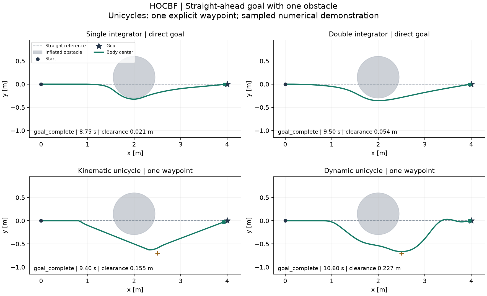
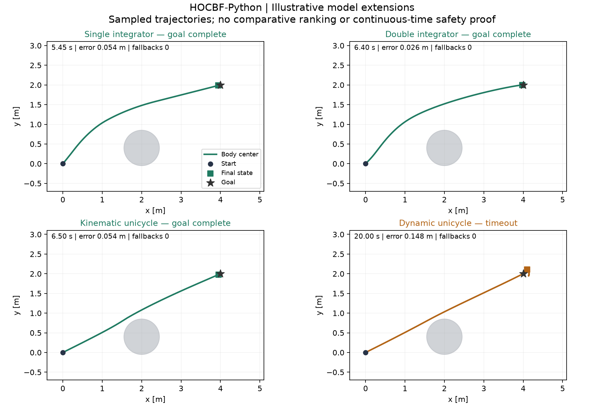

# Locally observed results

## Straight-ahead single-obstacle demo

The new [README demo and result table](../README.md#single-obstacle-demo) cover all four models, with explicit waypoint guidance for the unicycles. All four guided/demo configurations reached the settled goal; the [direct-goal diagnostic](../evidence/single_obstacle_direct/summary.json) retains both unicycle timeouts.

[Animation](../evidence/single_obstacle/animation.gif) · [Summary and current execution hashes](../evidence/single_obstacle/summary.json) · [Full records](../evidence/single_obstacle/)

## Earlier diagonal-goal fixture

The evidence below is the earlier execution snapshot. Its source hashes in `current_model_runs.json` identify that historical execution, including the earlier command-line module. They are not rewritten to imply that the old results were generated by the new demo entry point. Core model, controller and original simulation files remain unchanged.

| Model | Outcome | Steps | Final goal error (m) | Minimum sampled clearance (m) | Nominal fallbacks |
|---|---|---:|---:|---:|---:|
| single_integrator | goal_complete | 109 | 0.0541741 | 0.566607 | 0 |
| double_integrator | goal_complete | 128 | 0.0255947 | 0.60152 | 0 |
| kinematic_unicycle | goal_complete | 130 | 0.054247 | 0.147205 | 0 |
| dynamic_unicycle | timeout | 400 | 0.147538 | 0.114568 | 0 |

These are one illustrative fixture per model. Timeouts and nominal fallback counts are retained. Positive sampled clearance is not a continuous-time safety proof. No comparison ranking is inferred.

[Equation/solver checks](../evidence/current_equation_verification.json) · [Original execution](../evidence/current_original_execution.json) · [Run data and source hashes](../evidence/current_model_runs.json) · [Actual wheel installed in an independent environment](../evidence/public_wheel_verification.json)

Numerical states, inputs and solver events for every example are bundled under [evidence/examples](../evidence/examples/). Regenerate this figure with `python scripts/plot_results.py`.

The local-only source port checked all 300 ACC and 2,500 Robot2D QPs plus both full closed loops against saved native data. These checks do not relicense the author code.
